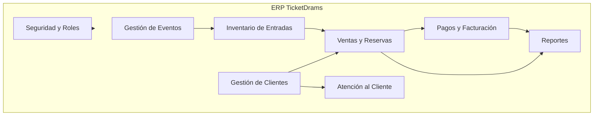
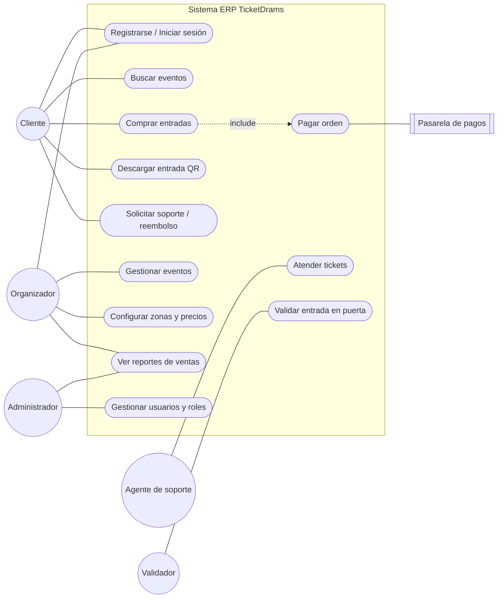
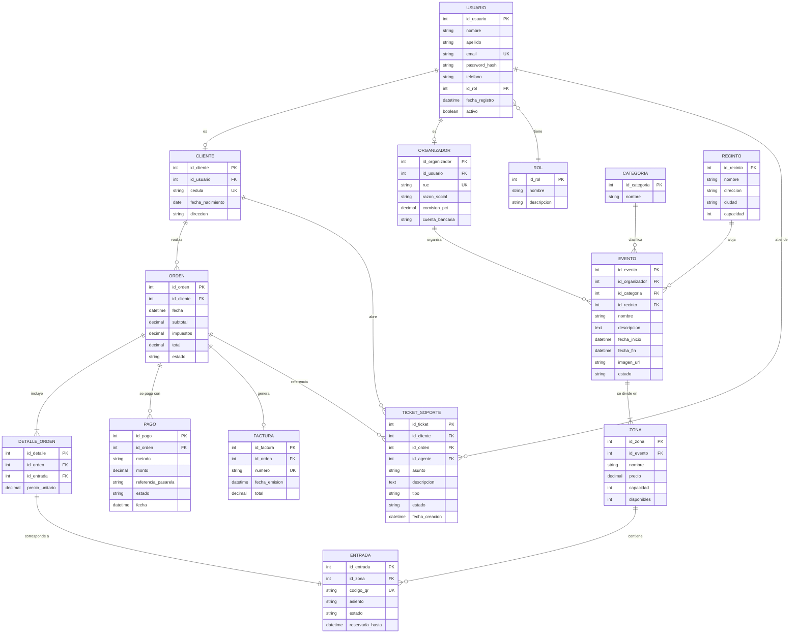
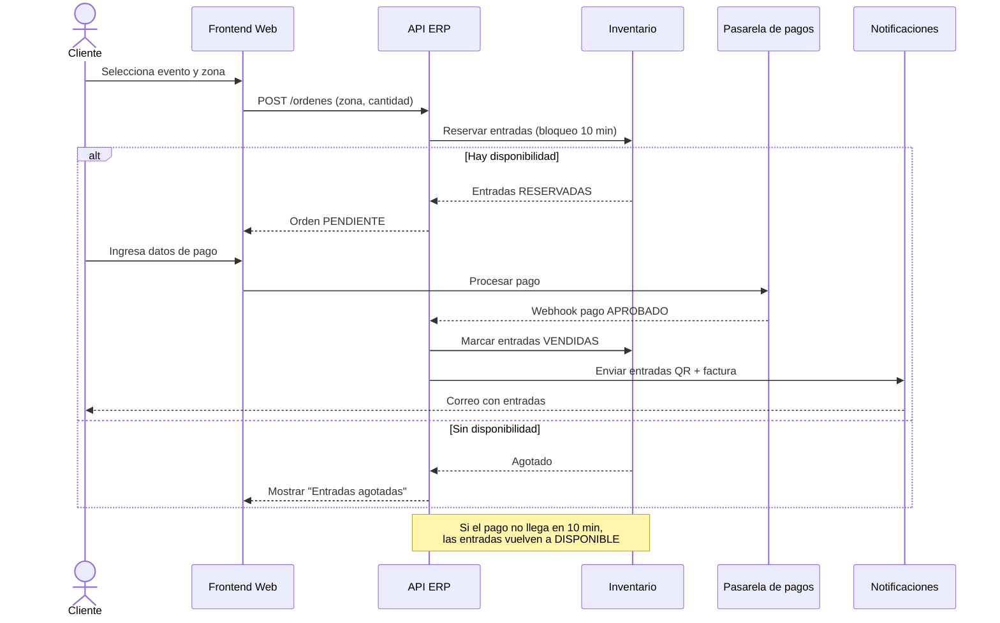
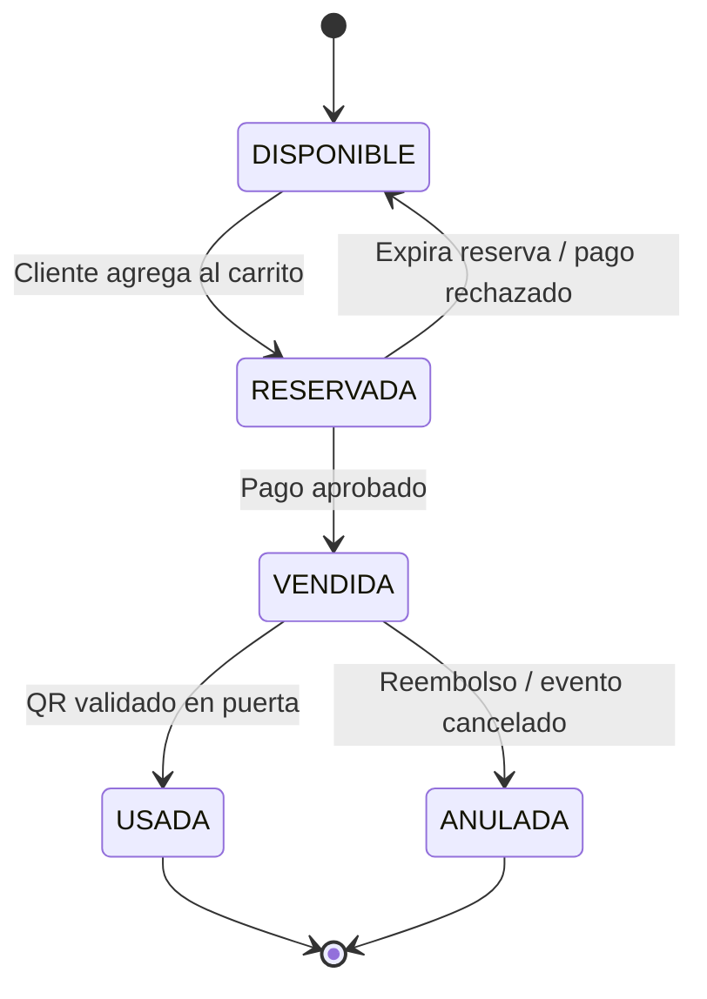
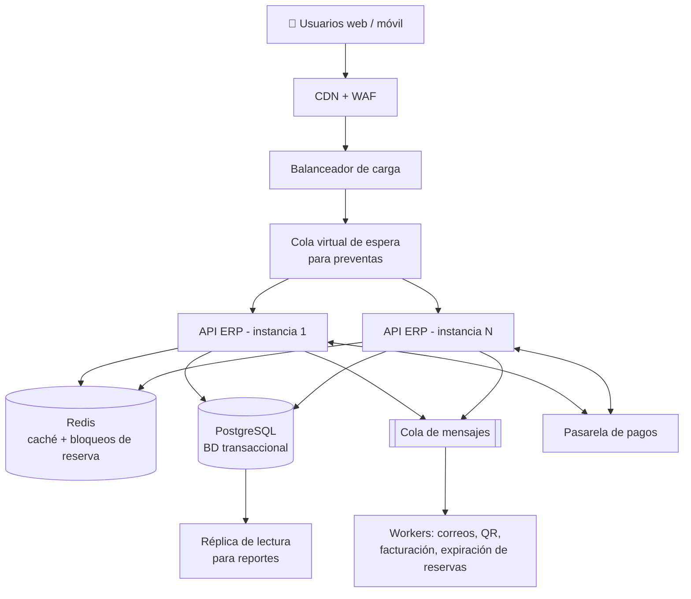

<div align="center">

# 🎟️ TicketDrams S.A.

### Sistema ERP de Venta de Entradas Online

*Una plataforma rápida, segura y económica para que los pequeños emprendedores vendan entradas a sus eventos*

<br/>


<br/>

**[📝 Descripción](#-descripción) · [🧩 Módulos](#-alcance-y-módulos) · [🗃️ Modelo de datos](#-modelo-de-datos-entidadrelación) · [🏗️ Arquitectura](#-arquitectura-propuesta) · [👨‍💻 Equipo](#-equipo)**

</div>

---

<table align="center">
  <tr>
    <td><b>🏫 Universidad</b></td>
    <td>Pontificia Universidad Católica del Ecuador</td>
  </tr>
  <tr>
    <td><b>🎓 Carrera</b></td>
    <td>Ingeniería en Sistemas de la Información</td>
  </tr>
  <tr>
    <td><b>📚 Asignatura</b></td>
    <td>Diseño de Sistemas de Información</td>
  </tr>
  <tr>
    <td><b>👨‍🏫 Docente</b></td>
    <td>Ing. Sebastián Tamayo</td>
  </tr>
  <tr>
    <td><b>👥 Integrantes</b></td>
    <td>Said Ñacata · Williams Quilligan · Ángel Yaguache</td>
  </tr>
  <tr>
    <td><b>📅 Fecha de propuesta</b></td>
    <td>27 de octubre de 2026</td>
  </tr>
</table>

---

## ✨ Características destacadas

<table>
  <tr>
    <td align="center" width="25%">⚡<br/><b>Alta velocidad</b><br/><sub>Respuesta &lt; 2 s incluso en preventas</sub></td>
    <td align="center" width="25%">🛡️<br/><b>Compra segura</b><br/><sub>Pagos vía pasarela certificada PCI-DSS</sub></td>
    <td align="center" width="25%">🎫<br/><b>Entradas QR</b><br/><sub>Únicas, digitales y validables en puerta</sub></td>
    <td align="center" width="25%">📊<br/><b>Reportes en vivo</b><br/><sub>Ventas, ocupación e ingresos al instante</sub></td>
  </tr>
  <tr>
    <td align="center">🚫<br/><b>Cero sobreventa</b><br/><sub>Reserva temporal con bloqueo</sub></td>
    <td align="center">☁️<br/><b>Siempre disponible</b><br/><sub>Escalado horizontal y cola virtual</sub></td>
    <td align="center">💰<br/><b>Económico</b><br/><sub>Comisiones bajas para emprendedores</sub></td>
    <td align="center">🤝<br/><b>Soporte integrado</b><br/><sub>Tickets, reclamos y reembolsos</sub></td>
  </tr>
</table>

---

## 📑 Tabla de contenido

1. [Descripción](#-descripción)
2. [Problema a resolver](#-problema-a-resolver)
3. [Objetivos](#-objetivos)
4. [Alcance y módulos](#-alcance-y-módulos)
5. [Actores del sistema](#-actores-del-sistema)
6. [Requerimientos](#-requerimientos)
7. [Modelo de casos de uso](#-modelo-de-casos-de-uso)
8. [Modelo de datos (Entidad–Relación)](#-modelo-de-datos-entidadrelación)
9. [Diccionario de datos](#-diccionario-de-datos)
10. [Modelo de procesos — Flujo de compra](#-modelo-de-procesos--flujo-de-compra)
11. [Diagrama de estados de la entrada](#-diagrama-de-estados-de-la-entrada)
12. [Arquitectura propuesta](#-arquitectura-propuesta)
13. [Stack tecnológico propuesto](#-stack-tecnológico-propuesto)
14. [Estructura del repositorio](#-estructura-del-repositorio)
15. [Cronograma](#-cronograma)
16. [Equipo](#-equipo)

---

## 📝 Descripción

**TicketDrams S.A.** propone el desarrollo e implementación de un **sistema ERP especializado en la venta de entradas online** para eventos culturales, deportivos, artísticos y de entretenimiento. El objetivo principal es **brindar un servicio económico a pequeños emprendedores** que organizan eventos.

La empresa busca diferenciarse mediante una solución tecnológica que optimice la gestión de ventas, mejore la experiencia del usuario y garantice la disponibilidad del servicio en todo momento.

El ERP integra módulos para la administración de eventos, control de inventario de entradas, gestión de clientes, procesamiento de pagos, generación de reportes y atención al cliente, permitiendo una **administración centralizada y eficiente** de todas las operaciones.

## ❗ Problema a resolver

Las plataformas actuales de venta de entradas presentan con frecuencia:

- ⏳ **Tiempos de espera elevados** al comprar.
- 💥 **Caídas del sistema** durante eventos de gran demanda.
- 🐢 **Procesos poco eficientes** para organizadores y compradores.

Esto afecta la experiencia de los usuarios y genera pérdidas económicas tanto para los clientes como para los organizadores. TicketDrams S.A. busca solucionar estas deficiencias con una plataforma moderna y optimizada que garantice un servicio de calidad.

## 🎯 Objetivos

### Objetivo general

Desarrollar un sistema ERP de venta de entradas online que optimice la gestión operativa de TicketDrams S.A., ofreciendo un servicio **rápido, seguro y confiable** para los usuarios.

### Objetivos específicos

1. Automatizar el proceso de venta y reserva de entradas.
2. Mejorar la velocidad de respuesta de la plataforma durante períodos de alta demanda.
3. Centralizar la gestión de eventos, clientes y transacciones.
4. Generar reportes en tiempo real para apoyar la toma de decisiones.
5. Incrementar la satisfacción del cliente mediante una experiencia de compra eficiente y segura.

## 🧩 Alcance y módulos

| # | Módulo | Responsabilidad principal |
|---|--------|---------------------------|
| 1 | **Gestión de Eventos** | Crear, editar, publicar y cancelar eventos; definir recintos, fechas y categorías. |
| 2 | **Inventario de Entradas** | Definir zonas/localidades, precios y cupos; controlar disponibilidad en tiempo real y evitar sobreventa. |
| 3 | **Gestión de Clientes (CRM)** | Registro, autenticación, perfil e historial de compras del cliente. |
| 4 | **Ventas y Reservas** | Carrito, reserva temporal de asientos, emisión de órdenes y entradas con código QR. |
| 5 | **Procesamiento de Pagos** | Integración con pasarela de pago, confirmación, reembolsos y facturación. |
| 6 | **Reportes y Analítica** | Ventas por evento, ocupación, ingresos por organizador, dashboards en tiempo real. |
| 7 | **Atención al Cliente** | Tickets de soporte, reclamos, solicitudes de reembolso y seguimiento. |
| 8 | **Seguridad y Administración** | Usuarios, roles, permisos y auditoría. |



## 👥 Actores del sistema

| Actor | Descripción |
|-------|-------------|
| **Cliente / Comprador** | Persona que busca eventos, compra entradas y solicita soporte. |
| **Organizador (emprendedor)** | Pequeño emprendedor que publica y administra sus eventos y consulta sus ventas. |
| **Administrador** | Personal de TicketDrams que gestiona usuarios, configuraciones, comisiones y reportes globales. |
| **Agente de soporte** | Atiende reclamos, consultas y reembolsos. |
| **Validador de acceso** | Escanea los códigos QR en la puerta del evento. |
| **Pasarela de pagos** *(sistema externo)* | Procesa cobros y reembolsos. |

## 📋 Requerimientos

### Funcionales

| ID | Requerimiento |
|----|---------------|
| RF-01 | El sistema debe permitir el registro e inicio de sesión de clientes y organizadores. |
| RF-02 | El organizador debe poder crear, editar, publicar y cancelar eventos. |
| RF-03 | El organizador debe poder definir zonas, precios y cantidad de entradas por evento. |
| RF-04 | El cliente debe poder buscar y filtrar eventos por fecha, ciudad y categoría. |
| RF-05 | El sistema debe reservar temporalmente las entradas seleccionadas (ej. 10 min) mientras se realiza el pago. |
| RF-06 | El sistema debe procesar pagos en línea mediante una pasarela externa. |
| RF-07 | El sistema debe generar entradas digitales con código QR único y enviarlas por correo. |
| RF-08 | El validador debe poder escanear y marcar como usada una entrada. |
| RF-09 | El sistema debe generar reportes de ventas, ocupación e ingresos en tiempo real. |
| RF-10 | El cliente debe poder abrir tickets de soporte y solicitar reembolsos. |
| RF-11 | El administrador debe poder gestionar usuarios, roles y comisiones. |

### No funcionales

| ID | Requerimiento |
|----|---------------|
| RNF-01 | **Disponibilidad:** ≥ 99.5 % de tiempo activo, incluso en preventas de alta demanda. |
| RNF-02 | **Rendimiento:** tiempo de respuesta < 2 s en el 95 % de las peticiones. |
| RNF-03 | **Escalabilidad:** escalado horizontal y cola virtual para picos de tráfico. |
| RNF-04 | **Seguridad:** HTTPS, contraseñas con hash, JWT, cumplimiento PCI-DSS delegando datos de tarjeta a la pasarela. |
| RNF-05 | **Consistencia:** ninguna entrada puede venderse dos veces (control de concurrencia). |
| RNF-06 | **Usabilidad:** interfaz responsive, compra en máximo 4 pasos. |
| RNF-07 | **Costo:** comisiones bajas, accesibles para pequeños emprendedores. |

## 🧭 Modelo de casos de uso



## 🗃️ Modelo de datos (Entidad–Relación)



## 📖 Diccionario de datos

| Entidad | Descripción | Valores de dominio relevantes |
|---------|-------------|-------------------------------|
| `USUARIO` | Cuenta base de cualquier persona que accede al sistema. | — |
| `ROL` | Perfil de permisos. | `CLIENTE`, `ORGANIZADOR`, `ADMIN`, `SOPORTE`, `VALIDADOR` |
| `CLIENTE` | Datos adicionales del comprador. | — |
| `ORGANIZADOR` | Emprendedor que publica eventos; guarda su comisión pactada. | — |
| `CATEGORIA` | Tipo de evento. | `Cultural`, `Deportivo`, `Artístico`, `Entretenimiento` |
| `RECINTO` | Lugar físico donde se realiza el evento. | — |
| `EVENTO` | Evento publicado por un organizador. | estado: `BORRADOR`, `PUBLICADO`, `AGOTADO`, `CANCELADO`, `FINALIZADO` |
| `ZONA` | Localidad del evento (VIP, General, Tribuna…) con precio y cupo. | — |
| `ENTRADA` | Unidad vendible del inventario. | estado: `DISPONIBLE`, `RESERVADA`, `VENDIDA`, `USADA`, `ANULADA` |
| `ORDEN` | Compra de un cliente. | estado: `PENDIENTE`, `PAGADA`, `CANCELADA`, `REEMBOLSADA` |
| `DETALLE_ORDEN` | Entradas incluidas en una orden. | — |
| `PAGO` | Transacción con la pasarela. | metodo: `TARJETA`, `TRANSFERENCIA`, `BILLETERA`; estado: `PENDIENTE`, `APROBADO`, `RECHAZADO`, `REEMBOLSADO` |
| `FACTURA` | Comprobante electrónico de la orden. | — |
| `TICKET_SOPORTE` | Caso de atención al cliente. | tipo: `CONSULTA`, `RECLAMO`, `REEMBOLSO`; estado: `ABIERTO`, `EN_PROCESO`, `RESUELTO`, `CERRADO` |

## 🔄 Modelo de procesos — Flujo de compra



## 🔁 Diagrama de estados de la entrada



## 🏗️ Arquitectura propuesta

Arquitectura en capas pensada para **alta disponibilidad** y **picos de demanda**:



**Decisiones clave**

- **Reserva temporal con bloqueo en Redis** → evita la sobreventa (RNF-05).
- **Cola virtual** → protege el sistema en preventas masivas (RNF-01, RNF-03).
- **Réplica de lectura** → los reportes en tiempo real no afectan las ventas.
- **Procesos asíncronos** (correo, QR, facturas) → respuestas más rápidas al usuario.
- **Datos de tarjeta solo en la pasarela** → menor riesgo y cumplimiento PCI-DSS.

## 🛠️ Stack tecnológico propuesto

> *Sujeto a cambios según el avance del curso.*

| Capa | Tecnología |
|------|-----------|
| Frontend | React + TypeScript, Tailwind CSS |
| Backend / API | Node.js (NestJS) o Spring Boot — API REST |
| Base de datos | PostgreSQL |
| Caché y bloqueos | Redis |
| Mensajería | RabbitMQ |
| Pagos | Pasarela local (ej. PayPhone / Kushki) o Stripe en modo prueba |
| Autenticación | JWT + bcrypt |
| Infraestructura | Docker, Docker Compose, despliegue en la nube |
| Modelado | Mermaid, draw.io / Lucidchart |
| Gestión | GitHub Projects, Git Flow |

## 📁 Estructura del repositorio

```text
rpacademico/
├── README.md
├── docs/
│   ├── propuesta/            # Propuesta del proyecto (PDF)
│   ├── requerimientos/       # Especificación de requerimientos
│   ├── modelos/              # Diagramas: casos de uso, ER, secuencia, clases
│   └── manuales/             # Manual de usuario y técnico
├── database/
│   ├── schema.sql            # Script de creación de tablas
│   └── seed.sql              # Datos de prueba
├── backend/                  # API del ERP
├── frontend/                 # Aplicación web
└── docker-compose.yml
```

## 📅 Cronograma

| Fase | Entregable | Estado |
|------|-----------|--------|
| 1. Propuesta | Documento de propuesta del proyecto | ✅ Completado (27/10/2026) |
| 2. Análisis | Requerimientos, actores y casos de uso | 🟡 En progreso |
| 3. Diseño | Modelo ER, diagramas de procesos y arquitectura | 🟡 En progreso |
| 4. Prototipo | Mockups de la interfaz | ⬜ Pendiente |
| 5. Implementación | Módulos principales del ERP | ⬜ Pendiente |
| 6. Pruebas | Pruebas funcionales y de carga | ⬜ Pendiente |
| 7. Entrega final | Sistema, documentación y presentación | ⬜ Pendiente |

## 👨‍💻 Equipo

<table align="center">
  <tr>
    <td align="center" width="200">
      <br/>
      <b>Said Ñacata</b><br/>
      <sub>Desarrollador · Analista</sub>
    </td>
    <td align="center" width="200">
      <a href="https://github.com/wdquilligana">
        
      </a><br/>
      <b>Williams Quilligan</b><br/>
      <sub>Desarrollador · Analista</sub>
    </td>
    <td align="center" width="200">
      <br/>
      <b>Ángel Yaguache</b><br/>
      <sub>Desarrollador · Analista</sub>
    </td>
  </tr>
</table>

<p align="center"><b>Docente:</b> Ing. Sebastián Tamayo</p>

---

<div align="center">

**TicketDrams S.A.** — *Tu evento, tu entrada, sin filas ni caídas.*

<sub>© 2026 · Proyecto académico · Pontificia Universidad Católica del Ecuador · Diseño de Sistemas de Información</sub>

</div>
